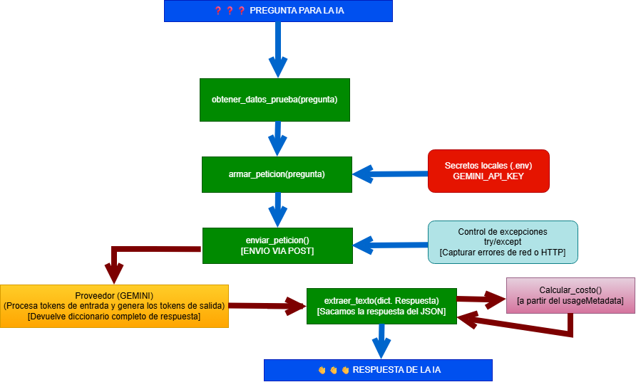

# Registro de Decisión de Arquitectura: Elección de Modelo

**Fecha:** 2026-10-20

## 1. Modelo Elegido
**`gemini-3.7-flash`**, para la funcionalidad principal de la miniaplicación.

## 2. Diagrama de Arquitectura

## 3. Comparación de Candidatos

| Criterio | Candidato A (`gemini-3.7-flash`) | Candidato B (`gpt-4o-mini`) |
| :--- | :--- | :--- |
| **Proveedor** | Google AI Studio | OpenAI |
| **Costo por 1M tokens entrada** | $0.75 USD | $0.15 USD |
| **Costo por 1M tokens salida** | $3.75 USD | $0.60 USD |
| **Latencia promedio observada** | ~1.10 - 1.30 segundos | ~1.25 - 1.50 segundos |
| **Ventana de contexto** | 1.000.000 tokens | 128.000 tokens |
| **Acceso a Nivel Gratuito** | Sí (sin tarjeta) | No (requiere saldo prepagado) |
| **Calidad para el caso de uso** | Muy buena (respuestas precisas y JSON estructurado) | Muy buena (alta consistencia) |
| **Fecha de medición** | 2026-10-20 | 2026-10-20 |

## 4. Justificación
Se seleccionó `gemini-3.7-flash` a pesar de tener un costo nominal por millón de tokens superior al de su competencia directa. La decisión se fundamenta principalmente en su **ventana de contexto de 1M de tokens**, la cual proporciona un margen indispensable para la incorporación de RAG (Generación Aumentada por Recuperación) de grandes volúmenes de datos en el Módulo 2. Además, permite a los desarrolladores realizar pruebas sin fricción financiera inicial mediante el nivel gratuito robusto de Google AI Studio, manteniendo una latencia promedio ligeramente inferior.

## 5. Alternativa Descartada y Por Qué
Se descartó `gpt-4o-mini`. Aunque ofrece un costo por token significativamente más bajo ($0.15 de entrada y $0.60 de salida), su límite de contexto de 128k tokens resulta restrictivo para las proyecciones a mediano plazo de la aplicación con la integración de RAG. Asimismo, la ausencia de un nivel gratuito sin tarjeta de crédito interfiere con la agilidad requerida en la fase inicial de pruebas y desarrollo.